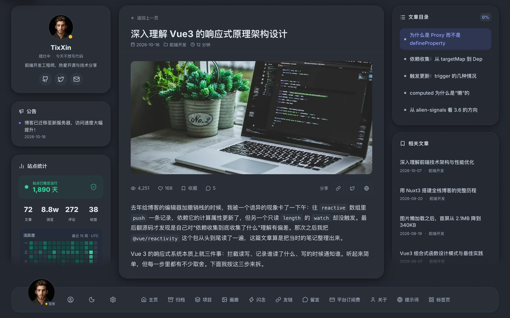

# TixXinBlog

[](https://github.com/TixXin/TixXinBlog/actions/workflows/ci.yml)
[](https://github.com/TixXin/TixXinBlog/actions/workflows/backend-ci.yml)
[](LICENSE)
[](https://nodejs.org/)
[](https://nuxt.com/)
[](https://nestjs.com/)

**中文** | [English](README.en.md)

面向单博主的个人博客系统，包含公开网站和内置创作后台。前端使用 Nuxt 4 / Vue 3，后端使用 NestJS / MikroORM / PostgreSQL。

在线实例：<https://tix.xin>（作者本人的博客，内容与本仓库的演示数据无关）。

<p align="center">
  
</p>
<p align="center">
  
  
</p>
<p align="center"><sub>默认主题 Nexus，使用仓库自带的演示数据</sub></p>

## 一条命令安装

准备一台 Linux 服务器（amd64 或 arm64），把域名解析到它并开放 80/443 端口，然后执行下面的命令，按提示填写域名。安装完成时会打印一条初始化链接，在浏览器打开即可创建博主账号。一键安装从 v0.3.0 起提供。

```sh
curl -fsSL https://github.com/TixXin/TixXinBlog/releases/latest/download/install.sh -o install.sh && sudo bash install.sh
```

没有服务器时，可以用下载好的 `install.sh` 先在本机试用（需要 Docker，不需要 sudo），完成后访问 `https://localhost:8443`：

```sh
bash install.sh --local
```

前提条件、脚本会做什么、日常管理命令和常见问题见 [5 分钟部署](docs/quick-start.md)；需要精细控制时见[部署指南](docs/deployment.md)的手动发布。想在本机开发则看下方[本地启动](#本地启动)。

## 可以做什么

- 写作与阅读：Markdown 文章、版本历史、评论审核、归档、正文搜索、RSS 和 sitemap。
- 内容展示：闪念、朋友圈、留言、图库、图片提示词、平台订阅费、项目和友链；文章、项目、图库可维护有序关联。
- 创作与运营：长文章节定位、媒体说明与引用查找、草稿工作台、站内通知和可配置邮件。
- 外观与维护：Nexus、Aurora、Dock 三套主题，站点/关于资料编辑，内容包迁入和完整备份恢复。
- 多语言界面：中文 / 英文界面，部署时用 `NUXT_PUBLIC_DEFAULT_LOCALE` 设定站点默认语言，访客可在界面设置中切换并记住选择；文章等博主内容不翻译。

文章等业务内容通过真实 API 持久化。书签仍保存在当前浏览器 LocalStorage；公开友链申请、访客邮件订阅尚未提供。邮件、自动备份和持续 worker 需要单独配置与启用。更多说明见[内容管理](docs/content.md)和[运行维护](docs/operations.md)。

## 环境要求

- Node.js **25.x**（`>=25 <26`）。
- pnpm **9.15.0**；以下命令通过可用的 Corepack 调用固定版本。
- PostgreSQL **16**。
- 使用仓库提供的数据库与部署编排时，需要 Docker 和 Docker Compose。

## 本地启动

以下步骤在仓库根目录执行。已有配置、数据库卷和账号应保留，不重复初始化。

1. **获取源码并安装依赖。**

   ```sh
   git clone https://github.com/TixXin/TixXinBlog.git
   cd TixXinBlog
   npm install --global corepack@0.34.6
   corepack pnpm install --frozen-lockfile
   ```

2. **准备两个服务的本地配置。** 首次分别将[前端模板](src/frontend/web-blog/.env.example)复制为同目录 `.env`，将[后端模板](src/backend/server-main/.env.example)复制为同目录 `.env.local`。不要覆盖已有文件。主要检查：

   | 后端配置                   | 要求                                       |
   | -------------------------- | ------------------------------------------ |
   | `DATABASE_URL`             | 指向准备使用的 PostgreSQL 数据库           |
   | `JWT_ACCESS_SECRET`        | 至少 32 字符的随机密钥                     |
   | `ADMIN_DEFAULT_USERNAME`   | 要初始化的博主登录名                       |
   | `ADMIN_DEFAULT_PASSWORD`   | 至少 12 字符的随机密码；不要使用模板占位值 |
   | `NODE_ENV` / `CORS_ORIGIN` | `development` / `http://localhost:3456`    |

   前端保留 `NUXT_PUBLIC_API_BASE_URL=/api/v1`，将 `NUXT_API_BASE_URL` 指向本机 API，模板值为 `http://127.0.0.1:3457/api/v1`。两个 Mock 开关均为 `false`。密钥和密码仅放在本地配置或受控环境中，不提交 Git。

3. **启动 PostgreSQL。** 已有 PostgreSQL 16 可直接使用；仓库的本机开发配置只需启动 `postgres` 服务：

   ```sh
   docker compose --env-file src/backend/server-main/.env.local -f src/backend/server-main/docker-compose.yml up -d postgres
   docker compose --env-file src/backend/server-main/.env.local -f src/backend/server-main/docker-compose.yml ps postgres
   ```

   等待状态为 healthy。该本机配置的用户、密码和数据库与后端模板默认 `DATABASE_URL` 对应；更换实例时请同步连接配置。端口冲突时同时调整 `POSTGRES_PORT` 与 `DATABASE_URL`。

4. **显式应用迁移并检查结构。**

   ```sh
   corepack pnpm --filter server-main migration:up
   corepack pnpm --filter server-main migration:check
   ```

5. **初始化管理员。**

   ```sh
   corepack pnpm --filter server-main build
   corepack pnpm --filter server-main exec node dist/admin-bootstrap.js
   ```

   初始化命令读取第 2 步的账号配置，不插入文章或开发样本；同名账号已存在时拒绝覆盖，已有账号跳过此步。

6. **启动前后端。**

   ```sh
   corepack pnpm dev:all
   ```

   此命令启动或复用本项目服务，不隐式迁移、seed 或清空数据库。后续可在另一个终端运行 `corepack pnpm dev:check` 检查链路。

7. **开始使用。** 打开[网站](http://localhost:3456)和[后台](http://localhost:3456/admin)，用初始化的账号登录，在站点设置中维护自己的资料，再创建内容。新库没有默认公开文章；开发样本的显式准备见[开发指南](docs/development.md)。

## 常用入口

| 用途                   | 路径                                                                  |
| ---------------------- | --------------------------------------------------------------------- |
| 文章、归档、跨类型搜索 | `/`、`/archive`、`/search`                                            |
| 平台订阅费             | `/subscriptions`；后台 `/admin/subscriptions`；访客记录仅存当前浏览器 |
| 图片提示词             | `/prompts`；博主登录后页内添加、编辑和管理草稿                        |
| 关于、项目、图库       | `/about`、`/projects`、`/gallery`                                     |
| 闪念、朋友圈、留言     | `/flash`、`/moments`、`/guestbook`                                    |
| 创作与资料维护         | `/admin`、`/admin/site`、`/admin/media`                               |
| 通知与备份管理         | `/admin/notifications`、`/admin/operations`、`/admin/maintenance`     |

## 仓库布局

```text
src/frontend/web-blog/    网站、管理界面和前端测试
src/backend/server-main/ API、迁移、开发样本和后端测试
docs/                    当前使用、架构与维护指南
scripts/                 开发启动、检查和发布工具
deploy/                  生产环境与 HTTPS 配置模板
patches/                 固定依赖版本所需的补丁
.github/workflows/       持续集成与版本发布
```

共享格式、提交钩子和依赖配置保留在根目录；个人编辑器配置和运行产物不进入版本库。模块内职责见[架构指南](docs/architecture.md)。

## 构建、部署与贡献

```sh
corepack pnpm build
corepack pnpm --filter server-main build
```

根目录 `build` 构建前端，后端单独构建；全部根脚本见[脚本说明](docs/scripts.md)。部署有一键安装（`install.sh` 与 `tixxin` 管理命令）和手动发布（`release.mjs`）两种方式，共用同一套镜像、编排和数据卷。生产编排使用 `compose.production.yaml` 和 `deploy/` 模板；部署前需要设置实际域名、固定镜像版本、密钥和持久化存储，并先执行迁移。推送 `v*` 标签后，Release 工作流会把 web、api、migration、worker 四个多架构镜像推送到 GHCR 并创建 GitHub Release；也可以在目标主机自行构建。两条路径、Linux/PowerShell 命令与本机生产式预览见[部署指南](docs/deployment.md)，数据维护见[备份与恢复](docs/backup-and-recovery.md)。

开发环境、代码职责、测试和 PR 要求见 [CONTRIBUTING.md](CONTRIBUTING.md)。[文档导航](docs/README.md)提供开发、架构、API、内容和主题说明。参与前请阅读[行为准则](CODE_OF_CONDUCT.md)。版本变更记录在 [CHANGELOG.md](CHANGELOG.md)。

## 安全

报告安全漏洞请走仓库的私密漏洞报告渠道，不要提交公开 issue，详见 [SECURITY.md](SECURITY.md)。

## 许可证

代码许可证见 [LICENSE](LICENSE)（GNU GPL v3），[LICENSE_CN](LICENSE_CN) 为同一协议的中文译本，仅供理解参考，发生歧义时以英文原文为准。第三方素材的来源和许可按其随附说明处理。
