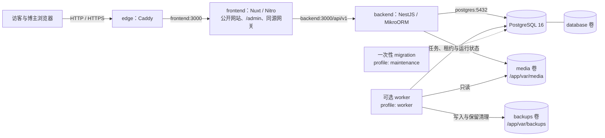
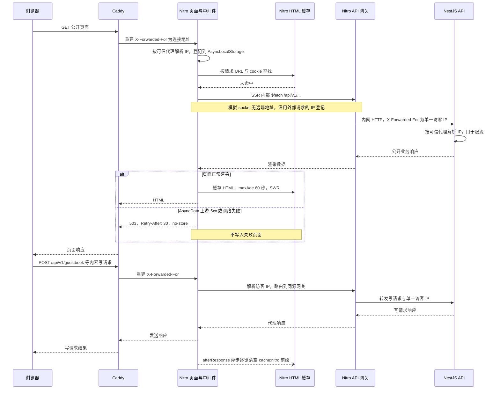
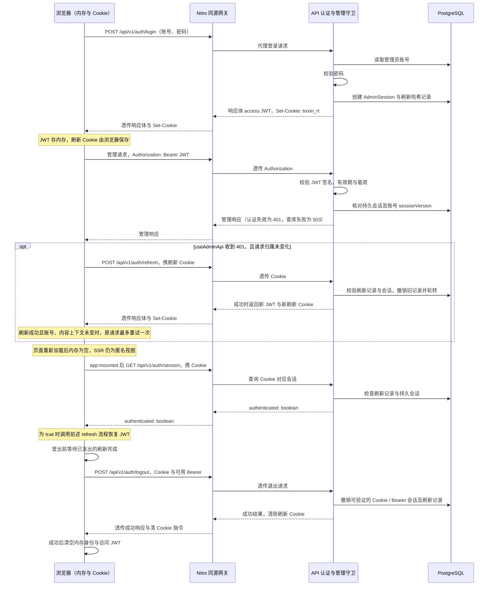

# 架构与代码入口

TixXinBlog 面向单博主创作与维护。Nuxt 4 / Vue 3 提供公开网站和内置 `/admin`，NestJS 11 / MikroORM 6 / PostgreSQL 16 提供持久化业务。运行基线为 Node 25 与 pnpm 9.15.0。

## 工作区与职责

```text
src/frontend/web-blog/       Nuxt 网站与管理界面
src/backend/server-main/     API、实体、迁移与维护工具
src/shared/subscription-domain/  订阅金额、日期、历史与统计的纯领域库
scripts/dev/                服务自检、进程归属与隔离启动验证
scripts/release/            发布预检、版本切换与生产式隔离验证
deploy/                     HTTPS 入口和生产环境模板
docs/                       使用、开发和长期维护指南
```

`web-blog` 和 `server-main` 是两个应用工作区；`@tixxin/subscription-domain` 是它们共用的纯领域包，不启动服务。它统一最小货币单位、精确聚合、日期锚点和价格事件校验，后端、访客本地模式及内容包/恢复均复用。后台位于 `web-blog/app/pages/admin/`，无需额外的管理端应用或启动命令。

前端业务请求通过同源 `/api/v1` 网关到达 API。`NUXT_API_BASE_URL` 仅在服务端使用；公开站点地址由运行配置提供，分享、canonical、RSS、JSON 订阅和 sitemap 不能固化为构建机器的地址。

## 整体部署拓扑

下图对应[生产编排](../compose.production.yaml)中的服务与持久卷；箭头表示请求、数据库连接或卷访问，虚线表示显式维护入口。



只有 `edge` 发布宿主 HTTP/HTTPS 端口，默认绑定 `127.0.0.1`；前端、API 与数据库端口仅在容器网络内使用。[Caddy 配置](../deploy/Caddyfile)将全部路径转给 Nitro，受管媒体同样经过 `/api/v1/media/<UUID>.webp` 网关后由 API 读取媒体卷，Caddy 与前端不挂载该卷。证书与 Caddy 运行配置分别保存在 `certificates:/data` 和 `caddy-config:/config`。

worker 通过数据库领取持久任务，与 API 共享 PostgreSQL 和媒体卷；备份卷仅挂载给 worker。持续循环需启用 `worker` profile 与 `OPERATIONS_WORKER_ENABLED=true`，邮件、自动备份还各自受环境开关、通道配置和数据库暂停状态约束，默认关闭。HTTP 启动不执行迁移、seed 或任务循环。执行入口见 [operations.mjs](../src/backend/server-main/scripts/operations.mjs) 与 [task-runner.ts](../src/backend/server-main/src/modules/operations/task-runner.ts)，部署条件见[部署指南](deployment.md#可选-worker-与运行观察)。

## 前端分层

下列目录相对 `src/frontend/web-blog/`：

| 路径                            | 职责                                               |
| ------------------------------- | -------------------------------------------------- |
| `app/pages/`                    | 路由、读取状态和页面组装，向组件传入数据           |
| `app/components/<domain>/`      | 展示与交互，通过 props/model/events 接收和返回状态 |
| `app/features/<domain>/`        | 领域类型、仓储、查询、编辑、校验和映射工具         |
| `app/composables/`              | 跨页面复用的请求、恢复、身份和界面生命周期         |
| `app/utils/`                    | 地址、差异、存储、焦点和排版等工具                 |
| `app/layouts/`                  | 公开壳层与独立管理工作区                           |
| `app/assets/styles/`            | SCSS、设计变量和共享样式                           |
| `themes/`、`theme-contracts/`   | 三主题实现和引擎分发契约                           |
| `server/routes/`、`server/api/` | Nitro 订阅、sitemap 数据源与同源 API 转发          |
| `tests/unit/`、`tests/e2e/`     | 单元和隔离浏览器回归                               |

单页使用 `xxx.vue`，有子流程时才使用 `xxx/index.vue`。数据类型位于领域目录，组件不直接导入业务 Mock。主题改变布局与表现，业务状态和网络请求仍由宿主管理。

公开列表复用 `usePublicReadData` 和 AsyncData 的加载/错误状态。缓存以当前 Nuxt 应用为所有者，按领域和规范化查询区分，列表有效期 30 秒、统计 60 秒，最多 32 项，UTF-8 序列化大小总计不超过 4MiB；历史结果不累积到深响应式 payload。五分钟内的过期结果可以先显示再重验证，更旧结果按冷读取处理，手动重试始终访问接口。连续文章和朋友圈列表只在前缀有效期内复用追加，刷新时重新核对完整已展示范围，不给旧前缀续期。

管理写入通过现有统一 API 入口撤销对应领域缓存；内容迁入、批处理票据确认、身份切换和公开互动也接入失效。失效同时取消读取并递增代次，迟到响应不能恢复已撤回内容。朋友圈、留言和闪念仍保留原有实体版本、草稿及互动状态；朋友圈和留言的公共页面缓存只保存公开条目编号与公开查询信息，显示内容从现有实体仓储读取。留言的个人分页索引由原留言缓存通过弱关联持有，随公共缓存淘汰释放，关联索引的体积也计入同一 4MiB 预算；不另建实体副本或淘汰队列。管理、认证、待审核内容和个人互动状态不进入公共读取缓存。其他会话的更新允许在有效期内短暂滞后。

生产环境的公开页面（首页、归档、朋友圈、项目、图库、闪念、友链、留言、关于、提示词、订阅、标签页与文章详情）在服务端缓存 SSR HTML 60 秒并以 stale-while-revalidate 续期；缓存键包含请求 URL 与 cookie 请求头，布局主题不同的请求分开缓存。SSR 本身始终是匿名视图，登录态在客户端恢复，缓存不改变这一点。该服务端 HTML 缓存与前述 Nuxt 应用内公共读取缓存分别失效，具体请求链路见下图。Nitro 不缓存 4xx/5xx 页面响应：AsyncData 记录的上游读取失败（5xx 或网络层失败）由 `app/plugins/ssr-render-status.server.ts` 将降级渲染改为 503，并附 `Retry-After: 30` 与 `Cache-Control: no-store`；页面仍带错误态输出，4xx 由页面各自处理。带缓存规则的路由会被 Nuxt 视为可预取 payload，因此 `experimental.payloadExtraction` 关闭，客户端切页继续走接口，避免每个可见链接都触发一次服务端整页渲染。

闪念沿用原有集合和读取代次，公开回访同样遵守 30 秒新鲜期与 5 分钟旧结果窗口；后台修改、内容恢复和页面内写入撤销旧读取，接纳写入结果时保留其他已保存的私有草稿。身份归属变化单独清理上一身份的集合，不把私人集合复制到公共 LRU。

## 请求链路与 SSR 缓存

下图展示生产环境一次未命中缓存的公开页读取，以及随后一次经同源代理的内容写请求。新鲜缓存直接返回 HTML；过期缓存可先返回旧 HTML，再在后台重渲染。客户端路由切换发起的 API 请求也走同一网关，不重新经过 SSR 渲染。



访客 IP 在 Nitro 由 `NUXT_TRUSTED_PROXY_CIDRS` 校验连接地址与 `X-Forwarded-For` 后登记；SSR 内部调用没有远端地址，沿用这份异步请求上下文，没有登记则保持空串。网关移除原有 `Forwarded`、`X-Real-IP`、`X-Forwarded-For`，只向 API 发送重新计算的单一地址。API 再按 `TRUSTED_PROXY_CIDRS` 信任来自 Nitro 的转发头，限流读取解析后的 `request.ip`。两端信任配置默认均为空，部署时必须填写实际受控代理地址；未配置时会按代理连接地址共享配额。当前 Caddy 模板直接接收访客连接，另加 CDN 或负载均衡时需重新核对信任边界，见[可信代理配置](deployment.md#可信代理读取配额与媒体缓存)。

HTML 清理钩子只匹配 `/api/v1/` 下非 `GET/HEAD/OPTIONS` 请求，排除路径以 `/view`、`/like` 结尾及 `/api/v1/auth/` 下的请求；匹配的失败写请求也会触发清理。清理在响应后异步执行，删除当前 Nitro storage 的 `cache:nitro` 前缀键，失败被捕获，不等待清理完成才返回写入结果；这不是数据库事务或跨实例广播。绕过 Nitro 的写入不会触发该钩子。

代码核对入口：[路由缓存规则](../src/frontend/web-blog/nuxt.config.ts)、[请求身份中间件](../src/frontend/web-blog/server/middleware/00.request-identity.ts)、[身份上下文](../src/frontend/web-blog/server/utils/requestIdentity.ts)、[同源网关](../src/frontend/web-blog/server/api/v1/[...path].ts)、[后端代理信任](../src/backend/server-main/src/bootstrap.ts)、[限流守卫](../src/backend/server-main/src/common/guards/rate-limit.guard.ts)、[清理判定与实现](../src/frontend/web-blog/server/utils/ssrCache.ts)、[响应后钩子](../src/frontend/web-blog/server/plugins/ssr-cache-purge.ts)、[降级状态插件](../src/frontend/web-blog/app/plugins/ssr-render-status.server.ts)。

## 后端分层

下列目录相对 `src/backend/server-main/`：

| 路径                                                   | 职责                                           |
| ------------------------------------------------------ | ---------------------------------------------- |
| `src/main.ts`、`src/bootstrap.ts`、`src/app.module.ts` | 配置引导、HTTP 启动、统一验证/响应和模块装配   |
| `src/config/`                                          | 环境校验、脱敏日志和显式 ORM 实体注册          |
| `src/common/`                                          | 认证、限流、内容上下文、审计和共享响应约定     |
| `src/entities/`、`src/migrations/`                     | 持久模型与正式迁移；实体变更同步注册和结构检查 |
| `src/modules/`                                         | 各域公开/管理接口、事务、聚合与投影            |
| `src/seeders/`                                         | 显式开发样本、稳定归属、目标核对及备份保护     |
| `scripts/`                                             | 迁移、完整备份/恢复、任务执行与备份接收器      |
| `tests/`                                               | 隔离 HTTP、数据工具、维护、恢复及运行验证      |

HTTP 启动不执行迁移、seed 或任务循环。生产后端 Dockerfile 提供 `runtime`、`migration`、`worker` 三种入口，各自职责见[部署](deployment.md)和[运行维护](operations.md)。

## 数据与能力边界

| 领域                                       | 数据与开放范围                                               |
| ------------------------------------------ | ------------------------------------------------------------ |
| 文章、评论、认证、闪念                     | 真实 API；文章和闪念保留显式演示仓储开关                     |
| 朋友圈、留言、图库、图片提示词、项目、友链 | 真实 API、独立实体及各自的公开/管理规则                      |
| 站点与关于资料                             | 版本化站点配置；公共响应剔除隐藏个人资料                     |
| 媒体                                       | 本地受管文件、实际图片信息及跨域引用；外链地址不由服务器抓取 |
| 平台订阅费                                 | 博主真实 API；访客记录独立保存在 LocalStorage，按原币种统计  |
| 书签                                       | 当前浏览器 LocalStorage，尚无 API 或云同步                   |
| 运营                                       | 真实待办聚合、站内通知、持久任务和可选 SMTP/备份通道         |

访客注册、多用户协作、公开友链申请、访客邮件订阅、外部仓库指标自动同步和完整流量分析不属于当前开放能力。页面预留与静态配置不代表服务已经实现。

平台订阅费公开页以单币种查看预算和清单，未指定有效 `currency` 时使用 USD；币种选择写入 URL，分类、状态与搜索同时约束统计和分页列表。管理后台仍可查看全部币种。本机订阅独立保留筛选，新增表单使用当前币种，成功保存后切到记录实际币种。完整详情、价格历史和续费预测按需展开，日期提醒不会执行扣款或发送通知。

文章演示开关为 `public.postUseMockRepo`，闪念为 `public.useMockRepo`；朋友圈和留言始终读取真实 API。演示只用于显式场景，API 失败必须反馈可恢复错误，不回退 Mock、不伪造空列表或零统计。开发样本也通过真实数据库和 API 读取。

## 身份、版本与请求所有权

单博主管理使用访问 JWT、HttpOnly 刷新 Cookie 和持久管理会话；访客标识由服务器转换为哈希，不是管理权限。退出、会话撤销、密码变更与完整恢复各自维护授权边界。

访问 JWT 有效期 15 分钟，仅保存在前端内存。刷新凭据是随机串，数据库仅保存 SHA-256 哈希，浏览器以 `tixxin_rt` Cookie 保存：`HttpOnly`、`SameSite=Lax`、`Path=/api/v1/auth`、有效期 7 天；除显式 `development/test` 外均带 `Secure`。刷新时撤销旧记录、签发新凭据，并延长持久会话有效期。SSR 不恢复登录态；客户端在 `app:mounted` 后先读取 `/auth/session`，确认有有效会话才刷新。



图中省略 Caddy 转发。Nitro 使用 `proxyRequest` 保留认证请求头和响应 `Set-Cookie`，不改写 Cookie 路径；刷新 Cookie 只随 `/api/v1/auth` 路径发送，普通管理接口依赖 Bearer。网关对带 `Origin` 的写请求校验同源，认证控制器另由 `AuthOriginGuard` 校验来源。持久会话撤销或账号会话版本变化会使后续管理鉴权失败，不必等 JWT 自然过期。`useAdminApi` 仅在客户端执行，刷新 401 会清内存身份，网络等其他刷新失败保留暂时无法确认的状态；退出失败不当作服务端已经撤销成功。

代码核对入口：[前端身份状态](../src/frontend/web-blog/app/composables/useCurrentUser.ts)、[挂载后恢复](../src/frontend/web-blog/app/plugins/auth.client.ts)、[管理请求与单次重试](../src/frontend/web-blog/app/composables/useAdminApi.ts)、[令牌与 Cookie 常量](../src/backend/server-main/src/modules/auth/auth.constants.ts)、[认证控制器](../src/backend/server-main/src/modules/auth/auth.controller.ts)、[会话与刷新轮转](../src/backend/server-main/src/modules/auth/auth.service.ts)、[管理守卫](../src/backend/server-main/src/common/guards/admin-auth.guard.ts)、[认证来源校验](../src/backend/server-main/src/common/guards/auth-origin.guard.ts)。

本机开发时浏览器、SSR 与工具可能同为 `127.0.0.1`，只有在 `NODE_ENV=development/test` 且显式设置 `RATE_LIMIT_DISABLED=true` 时才关闭后端限流；生产忽略该关闭开关。访客 IP 传递见[请求链路](#请求链路与-ssr-缓存)。

管理写入使用记录版本、稳定提交标识和内容上下文。`ContentContext.generation` 标识内容库代次，恢复/重建时轮换；旧页面不能重新登录后继续覆盖恢复出来的同编号内容。缺少必需上下文返回 428，过时代次或版本冲突返回 409。

前端读取和提交按账号、内容代次、请求序列与页面归属隔离。迟到响应不能覆盖新查询或新输入，取消旧请求不能吞掉当前请求的真实错误。未知写入结果先查询原提交/票据；本地恢复副本与服务器已保存内容分别展示，版本冲突必须重新读取并明确合并。

共享管理读取入口是 `useAdminReadResource`；完整约定见[API](api.md)。

## 内容、关系与媒体

`post`、`project`、`gallery_photo` 保存有向、有序的 `related_content`，公开响应仅解析仍可公开的目标。关联不等于媒体引用；文章修订和内容包编号映射必须保留关系语义。

媒体引用同时覆盖当前内容、草稿、归档、评论和历史修订。业务删除或换图只释放自身引用，其他引用继续阻止回收。媒体说明和替代文本独立，实际宽高/格式来自文件处理。

受管媒体 URL 是公开文件入口，持有有效地址即可读取；业务草稿、撤回或隐藏不意味着其媒体文件私有。图库外链与受管媒体互斥，友链 Logo 可为空或二选一。图库、提示词和友链的外链只保存经过校验的地址，服务器不下载或推断外站资料。平台订阅的自动 favicon 仅由管理员触发固定供应商代理，不能转发用户输入网址；缓存与正式媒体分离，受管图标继续使用媒体引用保护。

分类 `category` 是固定内容类型 `tech/life`；专栏 `folder` 与标签可维护。专栏改名、标签使用计数和内容写入共享事务及引用约束，公开统计仅计算公开明细。

## 维护与运行数据

内容包导出 v13、接受 v1–v12；内容迁入创建草稿或待审内容，按整批新编号映射关系。完整备份保存数据库、历史、授权、运行状态和登记媒体的一致快照；恢复先验证原始摘要，再撤销旧授权、轮换内容与运行代次并双暂停投递和自动备份。详见[备份与恢复](backup-and-recovery.md)。

`OwnerNotification` 保存事件与已读状态，业务处理状态实时解析；`BackgroundTask` 保存任务去重、租约、尝试次数和结果；`OperationControl` 管理运行代次和暂停。通知已读不代表评论已审核或已回复，SMTP 不确定结果也不能当作可安全重发。详见[运行维护](operations.md)。

文章列表按需投影字段，保留正文检索和业务响应；查询过滤、排序与聚合在服务端完成。新增缓存、搜索引擎或虚拟列表前，先用[开发指南](development.md)中的可重复方法建立证据。
